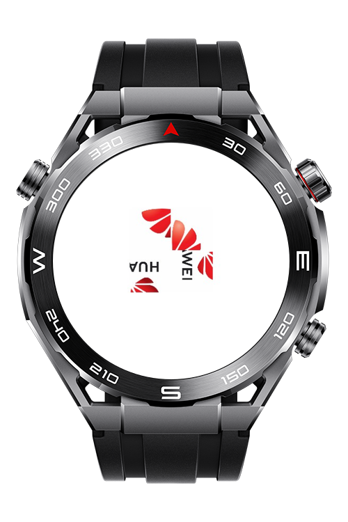
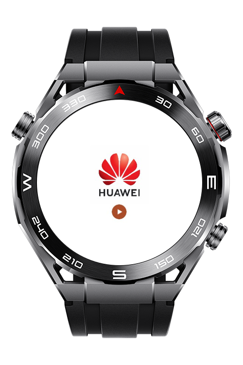
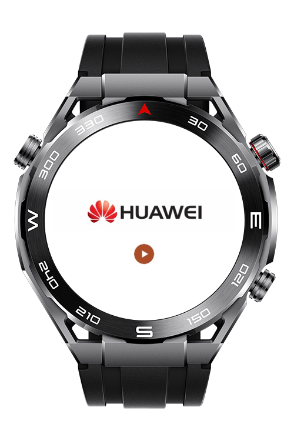
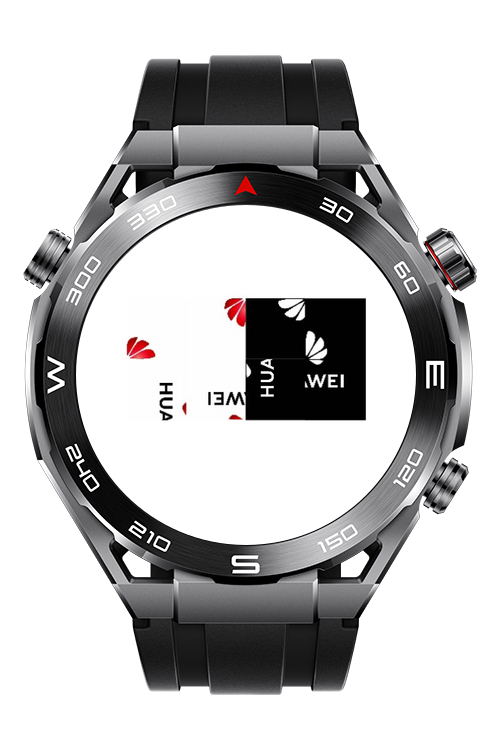

> **Note:** To access all shared projects, get information about environment setup, and view other guides, please visit [Explore-In-HMOS-Wearable Index](https://github.com/Explore-In-HMOS-Wearable/hmos-index).

# PieceIt

PieceIt is a simple yet challenging visual alignment game designed for Huawei Lite Wearable devices. 
Players rotate image tiles to correctly align all pieces and unlock the next level.
Each level features a unique grid layout and progressively increasing difficulty.

# Preview

<div>
    
    
    
    
</div>

# Use Cases

1. Cognitive Training:
Helps users improve spatial reasoning and visual perception by rotating and aligning image pieces correctly.

2. Casual Gaming Experience:
Provides an easy, touch-based puzzle game suitable for short play sessions on wearable devices like Huawei Watch 5.

3. Touch Interaction Demonstration:
Serves as an example for developers to learn about handling touch events (onclick) and swipe gestures (onswipe) in HarmonyOS ArkUI.

4. UI Animation Example:
Demonstrates the use of CSS keyframe animations (rotate0, rotate1, etc.) for smooth visual transitions on resource-limited smartwatch displays.

5. Progressive Level Design:
Offers an increasing challenge through three distinct grid layouts

6. Game State Management Practice:
Illustrates how to track and update UI state dynamically (imageStates, isWon) using reactive data binding.

7. Lightweight Game Prototype:
Can be used as a foundation for building more complex puzzle or logic-based games on HarmonyOS.
# Tech Stack

- **Languages**: Javascript
- **Frameworks**: HarmonyOS SDK 5.0.0(12)
- **Tools**: DevEco Studio Vers 5.1.0.842
- **Libraries**: @ohos.router
- 
# Project Directory
   ```
   src/main/js/MainAbility/pages/
   |---index
   |   |---index.css                     // CSS File for Level 1
   |   |---index.hml                     // HML File for Level 1
   |   |---index.js                      // JS File for Level 1
   |---level2
   |   |---level2.css                     // CSS File for Level 2
   |   |---level2.hml                     // HML File for Level 2
   |   |---level2.js                      // JS File for Level 2
   |---level3
   |   |---level3.css                     // CSS File for Level 3
   |   |---level3.hml                     // HML File for Level 3
   |   |---level3.js                      // JS File for Level 3
   ```

# Constraints and Restrictions
## Suported Devices
- Huawei Lite Wearable

**PieceItApp** is distributed under the terms of the MIT License
See the [LICENSE](./LICENSE) for more information.